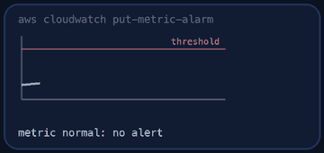
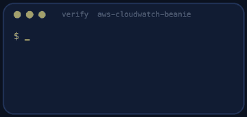
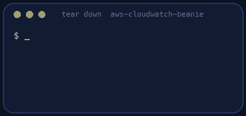

<p align="center"></p>

| | |
|-|-|
| **Time** | 105-120 min |
| **Cost** | free tier (a Lambda that runs once a minute, a few alarms, one dashboard) |
| **You need** | An AWS administrator user, the AWS CLI v2, Python 3 and a terminal |

## How this lab works

1. **Fork** this repository to your own GitHub account (button at the top right).
2. Clone **your fork** in your Ubuntu environment (WSL on Windows, your OrbStack machine on Mac).
3. Read the lab below (the same text is in [`LAB.md`](LAB.md)) and follow the mission.
4. Answer the questions in [`SUBMISSION.md`](SUBMISSION.md). Where a question asks for output, paste it in a code block. No screenshots needed.
5. Commit and push. Open the **Actions** tab of your fork (click *I understand my workflows, go ahead and enable them* the first time). The **Lab check** shows what is still missing.
6. When the check is green, **submit the URL of your fork** in the course platform.

> [!NOTE]
> The check only looks at your answers and any files the lab asks you to commit. Your instructor reads your work and may ask you to explain any line.

<p align="center"></p>

## 🎬 The situation

<p align="center"></p>

Beanie runs on AWS, and its logs flow into CloudWatch Logs whether you asked or not. They sit there as JSON text, kept for ever by default (and billed for ever), and nobody reads them. Last Thursday the order error rate was 40% for fifteen minutes. The first person to notice was a customer who called the owner.

CloudWatch has everything you need to notice first, spread over six services that must be wired together: **Logs** hold the lines, a **metric filter** turns the lines into numbers, **metric math** turns two numbers into a rate, an **alarm** watches the rate, an **SNS topic** carries the notification, and a **dashboard** shows it all to the person who has been woken up. Each piece is small. The skill is knowing how they fit and where each one lies to you (missing data, delays, periods).

> [!IMPORTANT]
> **Your mission**
> - Start an emitter that behaves like Beanie: every minute it writes 60 JSON request lines, and you control the failure rate
> - Set a retention on its log group, so you stop paying for ever
> - Turn log lines into the metrics `RequestCount` and `ErrorCount`
> - Create an alarm on the error **rate** (metric math) that notifies an SNS topic when it fires and when it recovers
> - Build a dashboard, save a Logs Insights query
> - Raise the error rate yourself and watch your alarm fire and recover
> - Tear down and prove it

**Time:** 105-120 min | **Cost:** free tier (one Lambda a minute, three small CloudWatch things) | **You need:** an AWS administrator user, the AWS CLI v2, Python 3 and a terminal.

<p align="center"></p>

## Part 0 - Start the emitter

Fork this repository, clone your fork and run:

```bash
./setup.sh
```

It creates a Lambda function `beanie-emitter` (read `emitter/handler.py`, it is 25 lines), a schedule that runs it every minute, and the role it needs. The function reads the failure rate (a percentage) from an SSM parameter, `/beanie-lab/error-rate`, which is `0` now. After a minute or two look at the logs:

```bash
aws logs tail /aws/lambda/beanie-emitter --since 5m | head -8
aws logs describe-log-groups --log-group-name-prefix /aws/lambda/beanie-emitter --query 'logGroups[].[logGroupName,retentionInDays,storedBytes]'
```

Each request is a JSON line with `level`, `status`, `route` and `duration_ms`. `retentionInDays` is empty: **never expire**.

> [!NOTE]
> **Think** Lambda created this log group by itself with no retention. Over a year of this emitter, how much would that cost, and who would notice? Set a retention of **7 days** now (`aws logs put-retention-policy`).

<p align="center"></p>

## Part 1 - From lines to numbers

A **metric filter** watches a log group and, for every line that matches a pattern, adds to a metric. For JSON logs the pattern syntax is `{ $.field = "value" }`.

Create two filters on `/aws/lambda/beanie-emitter`, both publishing into the namespace **`Beanie`** with a metric value of `1` per line and `defaultValue` `0` (so that a minute without matching lines publishes a zero instead of a gap):

| Metric | Pattern |
|--------|---------|
| `RequestCount` | every request line: `{ $.msg = "request" }` |
| `ErrorCount` | failures: `{ $.status >= 500 }` |

```bash
aws logs put-metric-filter --help | less
```

A metric filter is **not retroactive**: it only counts lines written **after** it exists. Wait two minutes, then see the numbers in the console (**CloudWatch > Metrics > Beanie**) or with `aws cloudwatch get-metric-statistics`.

> [!NOTE]
> **Predict** The emitter writes 60 lines per minute and the failure rate is 0. What do `RequestCount` and `ErrorCount` show for one minute? Now think about `defaultValue`: what would `ErrorCount` show without it?

<p align="center"></p>

## Part 2 - The alarm, on a rate

An alarm on the **count** of errors is a bad alarm: 5 errors a minute is a disaster at 6 requests a minute and nothing at 6,000. You want the **rate**, which needs **metric math**: an expression over two metrics.

Create the SNS topic **`beanie-alerts`** first (an email subscription is optional: it stays "pending" until someone confirms it, which is fine here). Then the alarm **`beanie-error-rate-high`**:

- a metric-math expression `100 * errors / requests` (`ReturnData: true`), with `ErrorCount` and `RequestCount` as `Sum` over `60` seconds (`ReturnData: false`);
- threshold **greater than 5** (percent);
- **3 evaluation periods, 3 datapoints to alarm**: three minutes in a row. One bad minute is noise, three is an incident;
- **`TreatMissingData: notBreaching`**, and think about why;
- **`AlarmActions` and `OKActions`** both pointing at the topic: you want to be told when it breaks **and** when it recovers.

```bash
aws cloudwatch put-metric-alarm --help | less
aws cloudwatch describe-alarms --alarm-names beanie-error-rate-high
```

The alarm starts in `INSUFFICIENT_DATA` and then goes to `OK`.

> [!NOTE]
> **Think** `TreatMissingData` has four values: `missing`, `notBreaching`, `breaching` and `ignore`. At 3 a.m. the traffic is zero for ten minutes and the metric has no datapoints. What does your alarm do with each of the four? Which is right for an alarm on an error *rate*, and which would you choose for an alarm on "the heartbeat must arrive every minute"?

<p align="center"></p>

## Part 3 - Dashboard and saved query

Create a dashboard named **`beanie`** (console: **CloudWatch > Dashboards**; CLI: `put-dashboard` with a JSON body) with at least these four widgets:

1. a line graph of the **error rate** (a metric-math expression over the two metrics, period 1 minute);
2. a graph of `RequestCount` and `ErrorCount`;
3. an **alarm status** widget with your alarm;
4. a **Logs Insights** table of the failing requests by route.

Save a Logs Insights query named **`beanie-top-errors`** (`fields @timestamp, status, route | filter status >= 500 | stats count() as errors by route | sort errors desc`).

> [!NOTE]
> **Think** Which widget would you look at first when your phone buzzes? Which would you look at first on a quiet Monday? Should they be the same?

<p align="center"></p>

## Part 4 - Break it on purpose

```bash
aws ssm put-parameter --name /beanie-lab/error-rate --type String --value 60 --overwrite
```

From the next minute, 60% of requests fail. Watch the dashboard and, in another terminal:

```bash
watch -n 20 "aws cloudwatch describe-alarms --alarm-names beanie-error-rate-high --query 'MetricAlarms[0].[StateValue,StateReason]' --output text"
```

Write down when you raised the rate, when the alarm went to `ALARM`, and when the notification action ran (`aws cloudwatch describe-alarm-history --alarm-name beanie-error-rate-high --history-item-type Action`). Three delays add up: the emitter writes once a minute, CloudWatch publishes metrics a little after the fact, and the alarm needs three consecutive datapoints. Then set the rate back to `0` and watch it recover.

> [!NOTE]
> **Predict** How long, at best, between "the failures start" and "the alarm fires" with a 60-second period and 3 datapoints? Is that acceptable for a cafe? What would you change to be faster, and what would that cost you in false alarms?

<p align="center"></p>

## Part 5 - Prove it

<p align="center"></p>

```bash
./verify.sh
```

It reads everything you built (retention, filters, topic, alarm, dashboard, saved query), then **raises the error rate itself** and waits for your alarm to fire, checks that the SNS action ran, lowers it and waits for recovery. It takes about 15 minutes and always sets the rate back to 0. Fix what is red and run it again until it ends with **ALL CHECKS PASSED**. Paste the output into `SUBMISSION.md` **before** you tear down.

> [!TIP]
> **Stuck?** `ErrorCount` has no data: the pattern is wrong (JSON patterns use `{ $.status >= 500 }`, with `$.`); remember filters are not retroactive. The alarm stays in `INSUFFICIENT_DATA`: with metric math both inputs need data; set `defaultValue` to 0. The alarm never fires: the threshold is a percentage (5, not 0.05), or the expression divides by zero. The action did not run: the topic ARN is missing from `AlarmActions`. The dashboard check fails: the alarm widget has `"type": "alarm"` and `properties.alarms` with the alarm's ARN.

<p align="center"></p>

## Level up (optional)

- Add a second alarm, a **composite alarm**, that fires only if the error rate is high **and** the latency alarm is firing. Why is that quieter?
- Add an alarm on the Lambda's own `Errors` and `Duration` metrics. What is the difference between "the function failed" and "the requests it logs failed"?
- Use **anomaly detection** instead of a fixed threshold for `RequestCount`. When is it better, and when does it learn the wrong normal?
- Subscribe a real e-mail address, confirm it, and trigger the alarm again. What does the message tell you, and what does it not?

<!-- teardown:start (generated by labs.py, do not edit) -->
## Tear down (mandatory)

<p align="center"></p>

Resources left behind cost money, keep doors open and pollute the next lab. Removing what you created is part of the job, so it is part of the submission: **you must prove it is gone**.

Do this **last**, after you have pasted your `verify` output into `SUBMISSION.md` (once you tear down, the lab can no longer be verified).

1. Run `./teardown.sh`. It removes the emitter function and its schedule and role, the parameter, the log group, your metric filters, alarms, dashboard, SNS topic and saved query.

Then run the proof:

```bash
./verify-teardown.sh
```

It prints a list of checks and must end with **TEARDOWN VERIFIED**. If it reports leftovers, remove them and run it again. Paste the full output in your submission.
<!-- teardown:end -->

<!-- submission:start (generated by labs.py, do not edit) -->
## 📬 Submission

Answer the questions in `SUBMISSION.md` in **your fork** (paste output in code blocks where asked), push, then submit the **URL of your fork**.

**Files to commit**

- `notes.md` with your commands (optional)

**Questions to answer**

1. Paste your two metric filters (pattern, metric name, namespace, value). Why can CloudWatch turn a log line into a metric, and what does a metric filter NOT do for log lines that arrived before it existed?
2. Paste your alarm definition. Explain period, evaluation periods and datapoints to alarm in your own words: why 3 of 3 one-minute datapoints and not 1 of 1? What does it trade (speed against false alarms)?
3. What is `TreatMissingData`? In this lab the filters publish nothing when there are no matching lines; which setting did you choose and what would happen to your alarm at 3 a.m. with each of the other settings?
4. Why is an alarm on the error RATE (errors divided by requests) better than an alarm on the error COUNT? Show the metric-math expression and a situation where the count alone would mislead.
5. Paste the alarm history lines that show your alarm going to ALARM and the SNS action being executed, and later back to OK. How long after you raised the error rate did it fire, and which three numbers (period, datapoints, publication delay) explain it?
6. Describe your dashboard: which widgets, which period, which statistic, and one decision it helps an on-call engineer make in ten seconds. Why put the alarm status on the dashboard?
7. Paste the output of `./verify.sh`. It must end with **ALL CHECKS PASSED**.
8. **Tear down.** Paste the output of `./verify-teardown.sh`. It must end with **TEARDOWN VERIFIED**.
<!-- submission:end -->
